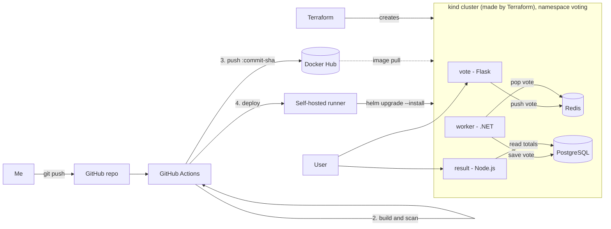
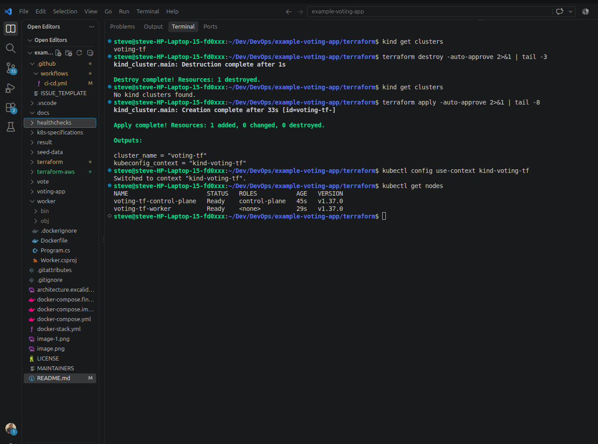
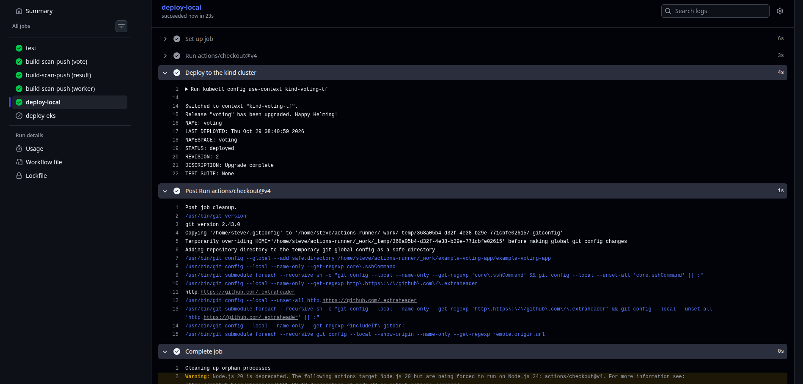
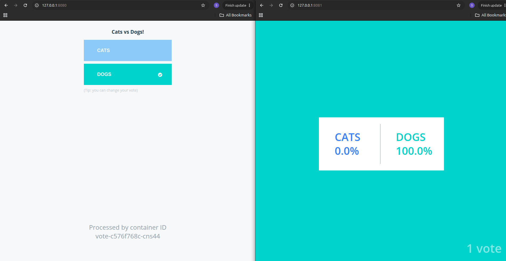
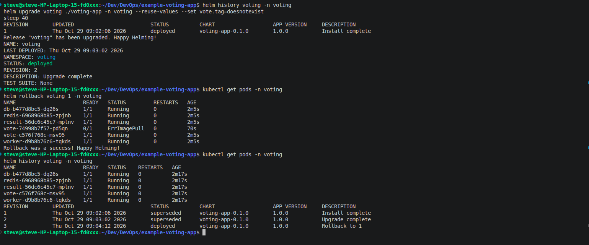

# Voting App: Ship It (DevOps Capstone 1)

This is my capstone for the DevOps Capstone Project 1. I took the Docker example voting app and built everything around it: safer containers, a Kubernetes cluster created with Terraform, a GitHub Actions pipeline that builds and deploys it, and a Helm chart so I can roll back a bad release.

Forked from [dockersamples/example-voting-app](https://github.com/dockersamples/example-voting-app).

## How it fits together



When someone votes, the vote app puts it in Redis. The worker picks it up and saves it in PostgreSQL. The result app reads the totals and shows them live.

## What's in the repo

| Path | What it is |
|---|---|
| `vote/`, `result/`, `worker/` | The three app services, each with its own Dockerfile and `.dockerignore` |
| `docker-compose.yml` | The original local dev setup |
| `docker-compose.final.yml` | Runs the production images the way they actually ship |
| `terraform/` | Creates the kind cluster I deploy to |
| `terraform-aws/` | EKS version of the cluster. It validates but I couldn't run it (explained in Step 3) |
| `voting-app/` | The Helm chart |
| `.github/workflows/ci-cd.yml` | The pipeline |
| `docs/` | Screenshots |

## What you need installed

Git, Docker (with Buildx), Terraform 1.5 or newer, kubectl, Helm, and a GitHub self-hosted runner on the same machine as the cluster. The `kind` CLI is optional, since Terraform creates the cluster for me. You only need the AWS CLI for the EKS code.

I built and tested this with Docker 29, Terraform 1.17, the `tehcyx/kind` provider 0.13.0, Helm 4.3 and kubectl 1.35.

## Step 1: Run it locally

```bash
docker compose up --build
```

Vote at <http://localhost:8080> and see the results at <http://localhost:8081>.

## Step 2: Safer containers

- Every base image is pinned to an exact version. Nothing uses `latest`.
- Nothing runs as root. Vote and worker use user ID 10001, and result uses the built-in `node` user (ID 1000).
- Every service has a `.dockerignore`. The one in `worker/` really matters. Without it, the `obj/` folder from my laptop got copied into the build and broke it.
- The vote Dockerfile has several stages, and I only set the non-root user in the final one. The normal `docker-compose.yml` builds the dev stage, so it never tests that. That's why I added `docker-compose.final.yml`.
- On Kubernetes, a non-root user can't use port 80 by default. The vote and result pods set a sysctl (`net.ipv4.ip_unprivileged_port_start=0`) to allow it.

To check the production images:

```bash
docker compose -f docker-compose.final.yml up --build -d
docker compose -f docker-compose.final.yml exec vote id     # uid=10001
docker compose -f docker-compose.final.yml exec result id   # uid=1000(node)
docker compose -f docker-compose.final.yml exec worker id   # uid=10001
docker compose -f docker-compose.final.yml down -v
```

## Step 3: The cluster, built with Terraform

The code in `terraform/` creates a small kind cluster with two nodes, one control plane and one worker. It saves the login details into `~/.kube/config`.

```bash
cd terraform
terraform init && terraform validate && terraform apply
kubectl config use-context kind-voting-tf
kubectl get nodes
```

To show it really rebuilds from code, I destroy it and bring it back:

```bash
terraform destroy
kubectl get nodes      # fails, the cluster is gone
terraform apply
kubectl config use-context kind-voting-tf
kubectl get nodes      # back again
```

A new cluster is empty, so the app needs deploying again. With my runner online I re-run the latest workflow in the Actions tab ("Re-run all jobs"). Starting a brand new run with "Run workflow" won't deploy, because the deploy job only runs on pushes. To do it by hand:

```bash
helm upgrade --install voting ./voting-app -n voting --create-namespace \
  --set global.registry=<dockerhub-user> --set global.tag=<commit-sha> \
  --set db.password=postgres --wait
```

One thing to be careful about: the kind provider keeps the cluster's private key in the Terraform state file and prints it in `plan` output. So the state file is git-ignored and I never commit it. My screenshots of Terraform only show the last few lines of output.

### Why I used kind instead of EKS?

The assignment asks for a cluster in the default AWS VPC. I wrote that in `terraform-aws/`, and it passes `terraform validate`, but I couldn't run it. My AWS account is part of an organization with a policy that blocks `ec2:DescribeVpcs` and `eks:DescribeCluster`. I tried six regions (us-east-1, us-east-2, us-west-2, eu-west-1, eu-west-2 and eu-central-1) and all of them were denied. After trying my best, I had to use a local kind cluster created with Terraform. The EKS deploy job is still in the pipeline. It stays skipped unless I set a repository variable called `DEPLOY_EKS` to `true`.

## Step 4: The pipeline

Every push to `main` runs `.github/workflows/ci-cd.yml`:

1. **test** installs the dependencies and does build and syntax checks on vote, result and worker, plus `helm lint`. The original project has no unit tests, so these are build checks, not functional tests.
2. **build-scan-push** builds each image, scans it with Trivy, and pushes it to Docker Hub tagged with the commit SHA. Right now the scan only reports. It doesn't fail the build (`exit-code: "0"`), so findings show up in the log but don't stop the push.
3. **deploy-local** runs on my own machine and uses Helm to deploy the new images to the kind cluster.
4. **deploy-eks** does the same for EKS, but is skipped unless `DEPLOY_EKS` is `true`.

Pull requests run the test, build and scan steps, but they don't push or deploy.

### Secrets and variables

| Name | What it's for |
|---|---|
| `DOCKERHUB_USERNAME`, `DOCKERHUB_TOKEN` | Pushing images |
| `DB_PASSWORD` | The database password given to Helm. It has to be `postgres` (see limitations) |
| `AWS_ACCESS_KEY_ID`, `AWS_SECRET_ACCESS_KEY`, `AWS_REGION` | Only for `deploy-eks` |
| `DEPLOY_EKS` (a variable, not a secret) | Turns on the EKS deploy job |

The three Docker Hub repos (`voting-vote`, `voting-result`, `voting-worker`) are public, because the kind cluster pulls images without logging in.

### The self-hosted runner

GitHub's own runners can't reach a cluster that lives on my laptop, so I installed a runner on my machine. It uses my `~/.kube/config`. Since it runs workflow code on my computer, I kept it safe like this:

- the deploy job only runs for pushes to `main`
- workflows from outside collaborators need my approval (Settings, Actions, General)
- I only start the runner when I'm deploying

## Step 5: Deploying and rolling back with Helm

The chart in `voting-app/` deploys vote, result, worker, Redis and PostgreSQL. Image names and tags live in `values.yaml`, and the pipeline overrides the tag with the commit SHA.

```bash
helm lint ./voting-app --set db.password=postgres
helm upgrade --install voting ./voting-app -n voting --create-namespace \
  --set global.registry=<dockerhub-user> \
  --set global.tag=<commit-sha> \
  --set db.password=postgres \
  --wait
kubectl get pods,svc -n voting
```

kind can't create real load balancers, so the services stay on `<pending>`. I use port-forward instead:

```bash
kubectl port-forward -n voting svc/vote 8080:80
kubectl port-forward -n voting svc/result 8081:80
```

### The rollback demo

I ship a broken release on purpose, then roll it back:

```bash
helm history voting -n voting
helm upgrade voting ./voting-app -n voting --reuse-values --set vote.tag=doesnotexist
kubectl get pods -n voting        # the new vote pod is stuck in ImagePullBackOff
helm rollback voting 1 -n voting  # use the number of the last good revision
kubectl get pods -n voting        # everything is Running again
helm history voting -n voting     # the rollback shows up as a new revision
```

I use `--reuse-values` so the upgrade keeps my commit tag and password and only changes the vote tag. The old vote pod keeps running while the new one fails, because of the readiness probe, so nobody sees an outage.

## Screenshots

| What | File |
|---|---|
| Destroying and rebuilding the cluster | `docs/terraform-rebuild.png` |
| A green pipeline run | `docs/pipeline-green.png` |
| The vote and result pages | `docs/app-running.png` |
| The rollback demo | `docs/rollback.png` |






## Security choices

- Pinned base images, and no containers running as root.
- Every image gets a Trivy scan before it's pushed. It's report-only for now.
- The database password isn't in the chart. It's passed in at deploy time from a GitHub secret and stored as a Kubernetes Secret.
- Pods have resource limits and readiness probes.
- State files and kubeconfig files are git-ignored because they hold cluster credentials.

## What isn't perfect

- PostgreSQL uses `emptyDir`, so if the database pod restarts, the votes are gone. A real setup would use a persistent volume.
- The original app code hardcodes the database login as `postgres/postgres`. The chart uses a Secret, but the app still expects that value, which is why `DB_PASSWORD` has to be `postgres`. Reading the password from an environment variable would be the proper fix.
- The packages in `vote/requirements.txt` aren't pinned, so image builds aren't exactly repeatable.
- The Trivy scan doesn't fail the build yet.
- Terraform state is stored locally. A remote backend would be better.
- I never got to apply the EKS version because of the organization policy above.
- Deploys only work while my machine and the runner are on.
- My kubectl (1.35) is older than the cluster (1.37), which is more than one version apart. Everything in this project still works, and updating kubectl would fix the mismatch.

## Problems I ran into

| What happened | Why | What fixed it |
|---|---|---|
| Worker build failed with `NETSDK1047` | My local `obj/` folder got copied into the build | Added `worker/.dockerignore` |
| `failed to parse platform` | Buildx wasn't installed | Installed `docker-buildx` |
| `ImagePullBackOff` on kind | Docker Hub repo was private, or the tag didn't exist | Made the repos public and checked the tag |
| `Unable to resolve action ... trivy-action` | I had pinned a version that doesn't exist | Used a real release tag |
| `explicit deny in a service control policy` | The AWS organization blocks those actions | Switched to kind |
| `Reference to undeclared input variable` | `variables.tf` was missing the `cluster_name` block | Added it |
| `no context exists with the name "kind-voting-tf"` | The cluster hadn't been created yet | Ran `terraform apply`, or `kind export kubeconfig --name voting-tf` |
| `deploy-local` waits forever | The self-hosted runner was off | Started `./run.sh` |

## Clean up

```bash
helm uninstall voting -n voting
cd terraform && terraform destroy
```