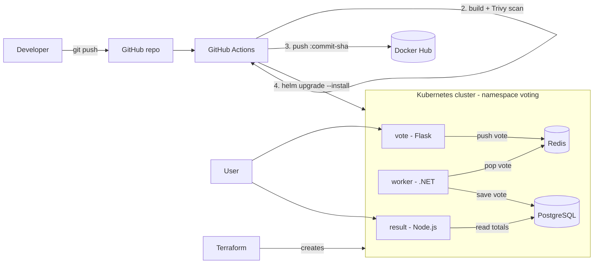
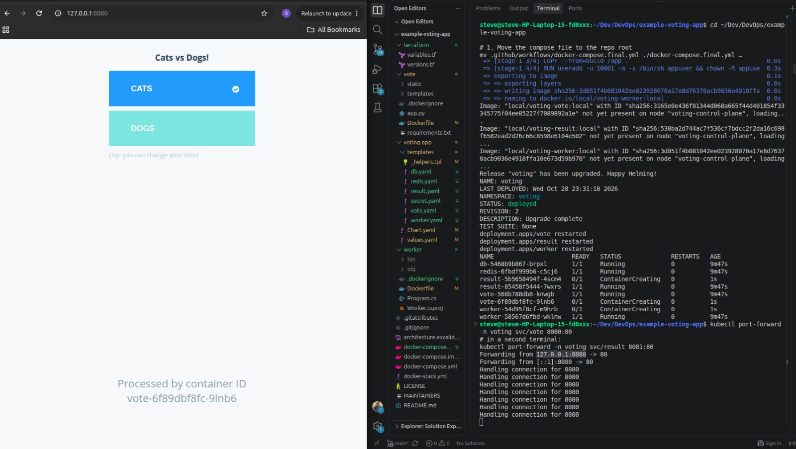
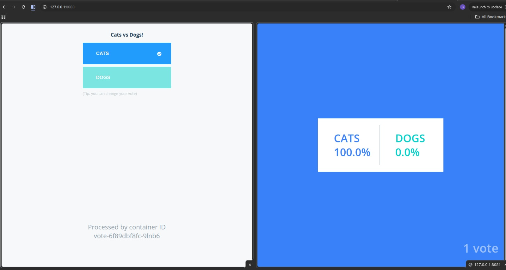

# Voting App: Ship It (DevOps Capstone 1)

A multi-service voting application containerized with Docker, provisioned on Kubernetes with Terraform, built, scanned and published by GitHub Actions, and deployed and rolled back with Helm.

Forked from [dockersamples/example-voting-app](https://github.com/dockersamples/example-voting-app).

## Architecture



Data flow: a user votes in **vote**, the vote waits in **Redis**, the **worker** stores it in **PostgreSQL**, and **result** shows live totals.

## Repository layout

| Path | Purpose |
|---|---|
| `vote/`, `result/`, `worker/` | Application services, each with its own Dockerfile and `.dockerignore` |
| `docker-compose.yml` | Local development stack (dev target, bind mounts) |
| `docker-compose.final.yml` | Tests the production images exactly as shipped |
| `terraform/` | EKS cluster in the default VPC |
| `voting-app/` | Helm chart (one chart, one values file) |
| `.github/workflows/ci-cd.yml` | Pipeline: test, scan, build, push, deploy |

## Prerequisites

Git, Docker with Buildx, Terraform >= 1.5, AWS CLI v2, kubectl, Helm 3, kind (local cluster), and optionally Trivy.

## Step 1: Run locally

```bash
docker compose up --build
```

Vote at <http://localhost:8080>, results at <http://localhost:8081>.

## Step 2: Containerization

- Base images are pinned to exact versions, never `latest`.
- Every service runs as a non-root user: UID 10001 for vote and worker, and the built-in `node` user (UID 1000) for result.
- Each service has a `.dockerignore`. In `worker/` it is essential, because a host `obj/` folder otherwise overwrites the container's restore output and breaks the build.
- `vote` uses a multi-stage Dockerfile. The non-root user is set only in the `final` stage.

Verify the production images:

```bash
docker compose -f docker-compose.final.yml up --build -d
docker compose -f docker-compose.final.yml exec vote id     # uid=10001
docker compose -f docker-compose.final.yml exec result id   # uid=1000(node)
docker compose -f docker-compose.final.yml exec worker id   # uid=10001
docker compose -f docker-compose.final.yml down -v
```

## Step 3: Infrastructure with Terraform

`terraform/` creates an EKS cluster and a managed node group (2 x t3.small) in the default VPC, plus the IAM roles they need.

```bash
cd terraform
terraform init && terraform validate && terraform apply
aws eks update-kubeconfig --name voting-app-cluster --region <region>
kubectl get nodes
```

Prove it rebuilds from code:

```bash
helm uninstall voting -n voting   # removes the load balancers first
terraform destroy
terraform apply
```

State files and `*.tfvars` are git-ignored. `.terraform.lock.hcl` is committed.

> **Environment note:** <explain the AWS service control policy block and what was agreed with the instructor, e.g. "My AWS account is governed by an organization SCP that denies ec2:DescribeVpcs, so `terraform apply` could not run. Terraform code is validated and plans were captured in `docs/`. The Helm and pipeline work was verified on a local kind cluster with the instructor's approval.">

## Step 4: CI/CD with GitHub Actions

Every push to `main` runs `.github/workflows/ci-cd.yml`:

1. **test**: dependency install and syntax or build checks for vote, result and worker, plus `helm lint`.
2. **build-scan-push**: builds each image, scans it with **Trivy** (fails on CRITICAL or HIGH), and only then pushes it to Docker Hub, tagged with the **commit SHA**. A vulnerable image never reaches the registry.
3. **deploy**: configures AWS credentials and runs `helm upgrade --install`, passing the commit SHA as the image tag.

Pull requests run the test, build and scan stages but do not push or deploy.

### Repository secrets

| Secret | Used for |
|---|---|
| `DOCKERHUB_USERNAME`, `DOCKERHUB_TOKEN` | Pushing images |
| `AWS_ACCESS_KEY_ID`, `AWS_SECRET_ACCESS_KEY`, `AWS_REGION` | Deploying to EKS |
| `DB_PASSWORD` | Injected into the chart at deploy time |

## Step 5: Deploy and roll back with Helm

The chart in `voting-app/` deploys vote, result, worker, Redis and PostgreSQL. All image names and tags come from `values.yaml` and can be overridden at install time.

```bash
helm lint ./voting-app --set db.password=<password>
helm upgrade --install voting ./voting-app -n voting --create-namespace \
  --set global.registry=<dockerhub-user> \
  --set global.tag=<commit-sha> \
  --set db.password=<password> \
  --wait
kubectl get pods,svc -n voting
```

On kind, use `kubectl port-forward -n voting svc/vote 8080:80` (and the same for `result` on 8081).

### Rollback demo

```bash
helm history voting -n voting
helm upgrade voting ./voting-app -n voting --reuse-values --set vote.tag=doesnotexist
kubectl get pods -n voting        # new vote pod: ImagePullBackOff, old pod keeps serving
helm rollback voting 1 -n voting
kubectl get pods -n voting        # all Running again
helm history voting -n voting     # the rollback appears as a new revision
```

Readiness probes keep traffic on the old pod while the bad release fails, so users see no downtime.

## Security decisions

- Non-root containers and pinned base images.
- Trivy gate before publishing.
- Database password comes from a Kubernetes Secret created from `--set db.password`, which the pipeline fills from a GitHub secret. It is never committed in the chart.
- Resource requests and limits on every pod.

## Known limitations

- PostgreSQL uses `emptyDir`, so votes are lost if the database pod restarts. A production setup would use a PersistentVolumeClaim with the EBS CSI driver.
- The upstream application code and `docker-compose.yml` hardcode `postgres/postgres`. The Kubernetes deployment uses a Secret, but the app code still expects that value. Making the code read the password from an environment variable is future work.
- Terraform state is local. A remote S3 backend with locking would be the next step.

## Troubleshooting notes

| Problem | Cause | Fix |
|---|---|---|
| Worker build failed with `NETSDK1047` | Host `obj/` copied into the build | Add `worker/.dockerignore` |
| `failed to parse platform` | Buildx not installed | Install `docker-buildx` |
| Pods in `ImagePullBackOff` on kind | Images not loaded into the cluster | `kind load docker-image ...` |
| `explicit deny in a service control policy` | AWS Organization policy | Ask the account admin |

## Clean up

```bash
helm uninstall voting -n voting
cd terraform && terraform destroy
kind delete cluster --name voting
```


